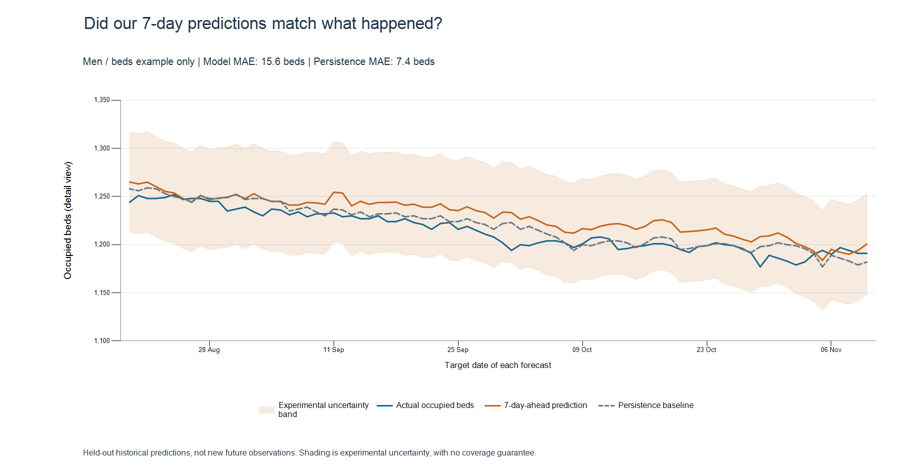

# Kinesis-Housing-Safety-Net-Shelter-Capacity

Pod 2 research prototype for Toronto housing safety-net forecasting. The project
downloads official public data, cleans and maps observations into a provisional
KinesisIQ events schema, trains predictive models, and compares their forecasts
with simple baselines using chronological evaluation.

## Project scope

- Shelter occupancy forecasts at 7, 14, and 30 days, separated by sector and by
  beds versus rooms.
- Citywide waiting-list backlog forecasts at 1, 2, and 4 quarters.
- Reproducible source snapshots, data-quality checks, abstract measures,
  exploratory operational clustering, reports, and charts.

For CAT 2, focus on the **Men sector, occupied beds seven days ahead**. On the
saved final holdout of 84 observations, persistence achieved MAE **7.37 beds** and
RMSE **9.54 beds**, compared with **15.64 beds** and **17.46 beds** for gradient
boosting. The model did not improve on the baseline. These are research results,
not an operational early warning service or a completed personal assessment.

## Quick start

Use **Python 3.12** to reproduce the pinned dependency environment. From the
repository folder on Windows:

```powershell
py -3.12 -m venv .venv
.\.venv\Scripts\python.exe -m pip install -r requirements.txt
.\.venv\Scripts\python.exe -m unittest discover -s tests -v
.\.venv\Scripts\python.exe -m pod2 all
.\.venv\Scripts\python.exe -m pod2.verify
```

On macOS/Linux use `python3.12` and `.venv/bin/python` instead. No OpenAI API key
or paid service is required. A full run downloads roughly 86 MB of source data.

To regenerate the report and charts from an existing local run:

```powershell
.\.venv\Scripts\python.exe -m pod2 report
```

Matplotlib provides cross-platform plotting. Windows also has an offline chart
renderer fallback. See [README.txt](README.txt) for individual stage commands,
snapshot reuse, data definitions, and team workflow.

## Saved results and evidence

The committed results come from the **11 November 2026 snapshot**, with shelter
observations through **10 November 2026**. They were not refreshed for this
repository upload. Download this repository to open the HTML report locally;
GitHub displays HTML source rather than executing it.

- [Research report](artifacts/research_report.html)
- [Shelter model comparisons](artifacts/shelter_metrics.csv)
- [Shelter forecasts](artifacts/shelter_forecasts.csv)
- [Backlog model comparisons](artifacts/backlog_metrics.csv)
- [Real source rows and mapped events](artifacts/mapped_samples.json)
- [Source provenance and data quality](artifacts/data_quality.json)
- [Chart provenance](artifacts/chart_manifest.json)
- [Pipeline report](artifacts/shelter_pipeline_report.txt)



Raw downloads, the local events database, serialized models, virtual
environments, caches, and local environment files are excluded from Git.
Run the pipeline to recreate them. Later source downloads can contain revisions;
exact replication of the original experiment requires its original raw snapshot.

## Limitations and remaining work

All forecasts are **research-only**. The saved outputs explicitly flag models
that lose to persistence or whose uncertainty bands have inadequate observed
coverage. The illustrative pressure threshold is not an approved operational rule.

The official KinesisIQ schema, sanitized eviction inputs, geographic enrichment,
historical waiting-time targets, and forthcoming RGI supply data remain pending.
Existing housing stock is not treated as future unit delivery. Backtests use a
potentially revised historical snapshot, not reconstructed historical publication
vintages. See [the modelling contract](docs/modelling_contract.txt) and
[remaining implementation work](docs/next_steps.txt).

Public data is supplied by the City of Toronto under its Open Government Licence;
publisher metadata and resource identifiers are retained in
[source metadata](artifacts/source_metadata).
